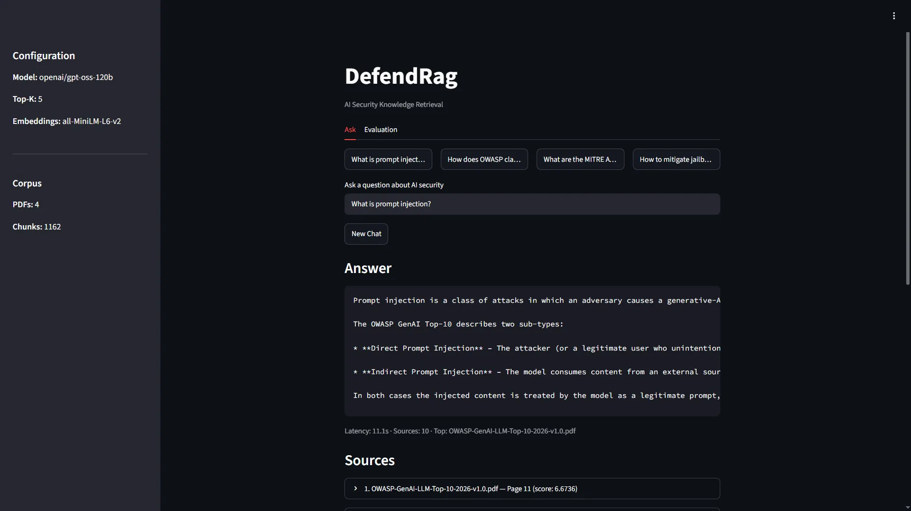
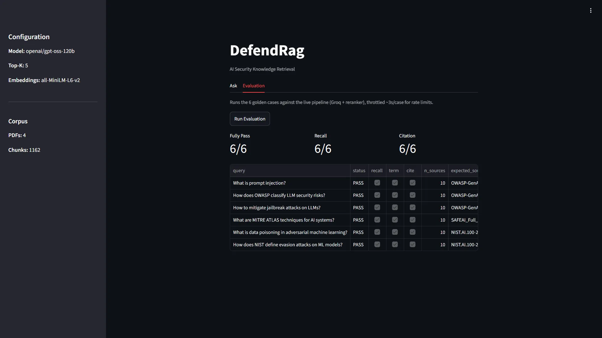

# DefendRag

**An agentic Retrieval-Augmented Generation (RAG) system for
cybersecurity knowledge retrieval.**

DefendRag answers cybersecurity questions using a collection of
documents. It combines keyword and semantic retrieval with cross-encoder
reranking to select relevant passages before generating an answer with
source citations.

The project explores RAG architecture, retrieval quality, and answer
traceability. It is a work in progress; the evaluation described below
is a basic regression harness, not a formal security certification.

## Demo

<p align="center">
  
  
</p>

## Key Features

-   **Hybrid retrieval:** Combines SQLite FTS5 keyword search with
    vector search using SentenceTransformers embeddings.
-   **Cross-encoder reranking:** Re-scores retrieved passages to
    prioritize relevant context.
-   **Workflow orchestration:** Uses LangGraph to coordinate the
    retrieval and answer-generation pipeline.
-   **Source-backed answers:** Returns answers alongside source
    references.
-   **Evaluation harness:** Includes a golden question set to check
    document retrieval, expected answer terms, and source citations.
-   **OpenAI-compatible model endpoint:** Can work with compatible model
    APIs, depending on the configured endpoint.

## Architecture

```text
                         User Query
                              |
                              v
                       LangGraph Workflow
                              |
                              v
                        Hybrid Retrieval
                       /                \
                      v                  v
               Keyword Search       Vector Search
                (SQLite FTS5)       (Embeddings)
                       \                /
                        v              v
                         Merge Results
                              |
                              v
                     Cross-Encoder Rerank
                              |
                              v
                         Select Top-K
                              |
                              v
                       LLM Generation
                              |
                              v
                       Answer + Sources
```

The pipeline separates candidate retrieval, reranking, and generation so
that retrieval behavior can be inspected and evaluated independently of
the language model's final response.

## Technology Stack

-   Python (requires 3.12+, see `.python-version`)
-   LangGraph
-   SQLite FTS5
-   SentenceTransformers
-   Cross-encoder reranking
-   Streamlit
-   OpenAI-compatible LLM APIs

## Getting Started

### 1. Clone the repository

```bash
git clone https://github.com/Bechir-98/DefendRag.git
cd DefendRag
```

### 2. Configure the environment

Create a local environment file from the example:

```bash
cp .env.example .env
```

Edit `.env` to configure the model endpoint and any required
credentials. Do not commit secrets or API keys.

### 3. Install dependencies

```bash
python -m venv .venv
source .venv/bin/activate   # .venv\Scripts\activate on Windows
pip install -e . && pip install tqdm
```

(`tqdm` is imported by `ingestion.py` but not yet declared in
`pyproject.toml`, hence the extra install step.)

### 4. Index documents

Place the source PDFs in the `data/` directory (any subdirectory
structure works, e.g. `data/owasp/`, `data/mitre/`, `data/nist/`):

```text
data/
├── owasp/
│   └── OWASP-GenAI-LLM-Top-10-2026-v1.0.pdf
├── mitre/
│   └── SAFEAI_Full_Report.pdf
└── nist/
    └── NIST.AI.100-2e2025.pdf
```

The `data/` directory is not shipped with the repository — source the
PDFs yourself from their publishers (OWASP, MITRE, and NIST). The
evaluation harness expects the exact filenames shown above; if you index
a different corpus, update the `expected_source` entries in the `GOLDEN`
list in `eval.py`.

Then build both indexes (keyword + vector):
```bash
python index.py
```

The first run downloads the embedding and cross-encoder models to
`~/.cache/huggingface`, which can take a while and needs network access.

### 5. Launch the application

```bash
streamlit run app.py
```

### 6. Run the evaluation harness

```bash
python eval.py
```

For a retrieval-only check without any LLM call:

```bash
python search.py
```

## Evaluation

The current evaluation harness uses a predefined set of questions to
check aspects such as expected document retrieval, expected answer
terms, and source citations.

These checks are useful for basic regression testing, but they do
**not** by themselves establish factual correctness, citation
faithfulness, resistance to prompt injection, or production readiness.

Useful next steps for evaluation include:

-   Expanding the question set and documenting its composition.
-   Comparing keyword-only, vector-only, hybrid, and
    hybrid-plus-reranking retrieval.
-   Measuring retrieval metrics such as Recall@k and MRR or nDCG.
-   Evaluating citation support, answer faithfulness, and appropriate
    abstention.
-   Testing contradictory documents, missing evidence, and prompt
    injection in retrieved content.

## Security Considerations and Limitations

DefendRag focuses on retrieving cybersecurity knowledge and generating
source-backed answers. A RAG pipeline is not automatically secure simply
because it uses citations or an agent framework.

Retrieved documents should be treated as untrusted input. Before using
the system in a sensitive environment, test prompt-injection handling,
access controls where applicable, citation correctness, and behavior
when the available evidence is insufficient.

## Roadmap

-   Broaden the evaluation dataset.
-   Add controlled retrieval and reranking comparisons.
-   Improve evidence-sufficiency and abstention checks.
-   Evaluate citation faithfulness and adversarial document handling.
-   Document measured performance and known limitations.
